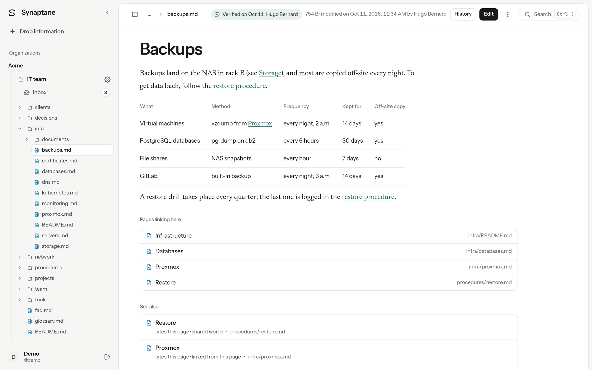
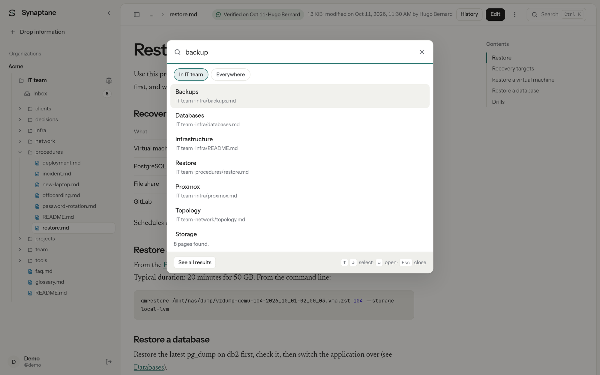
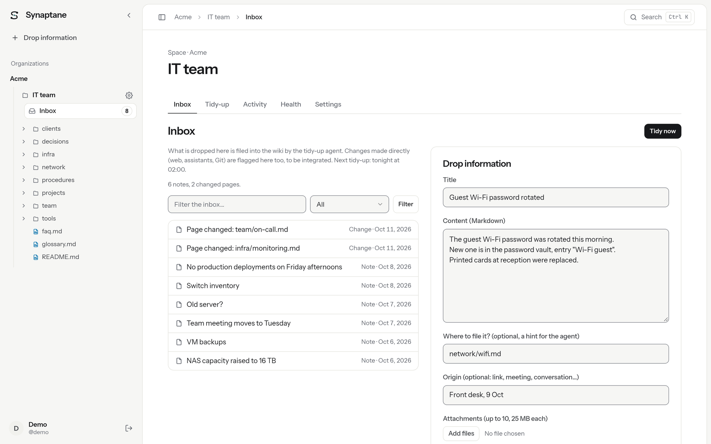
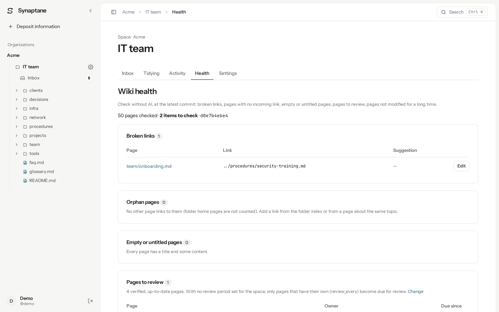
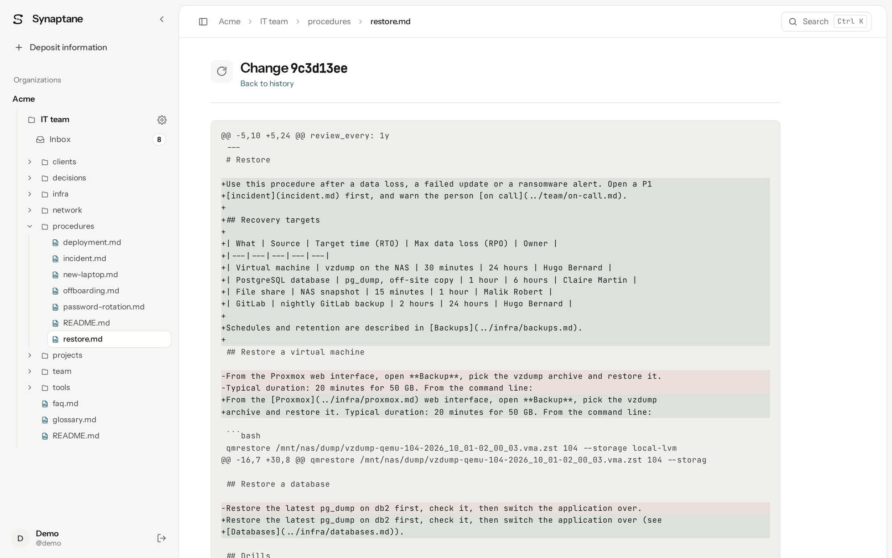
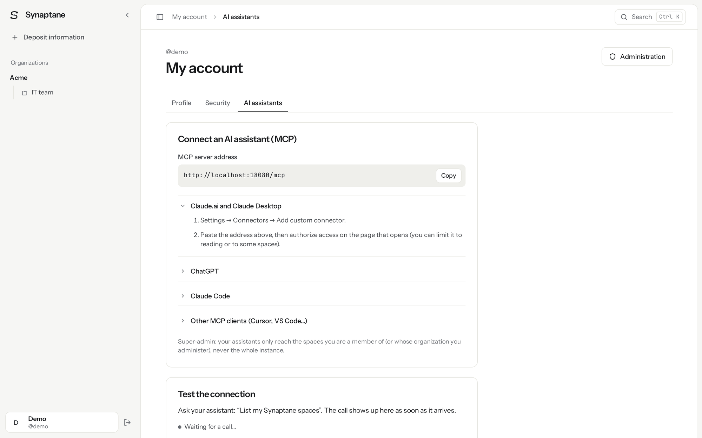
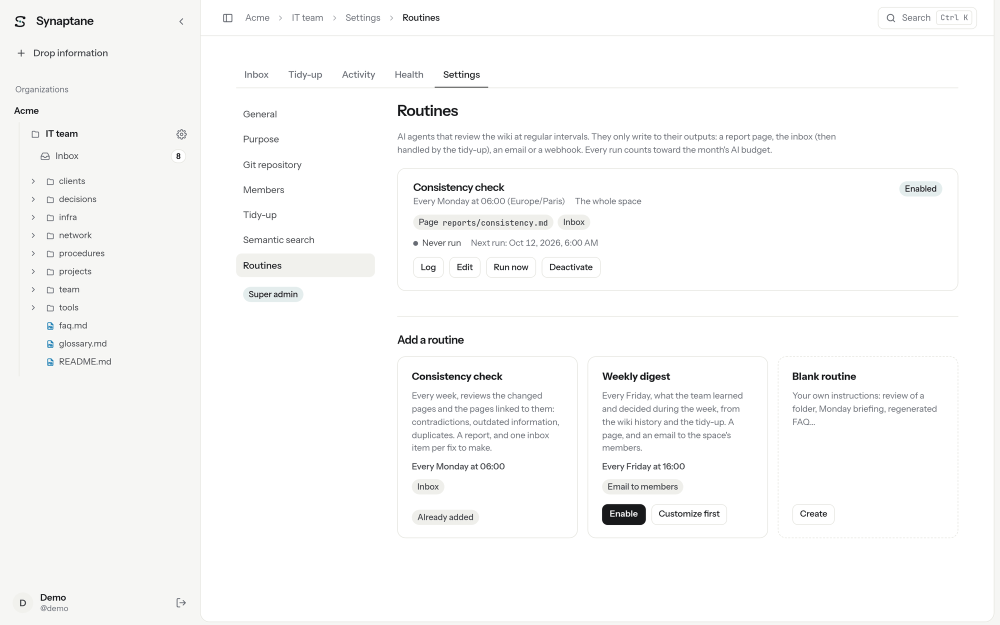
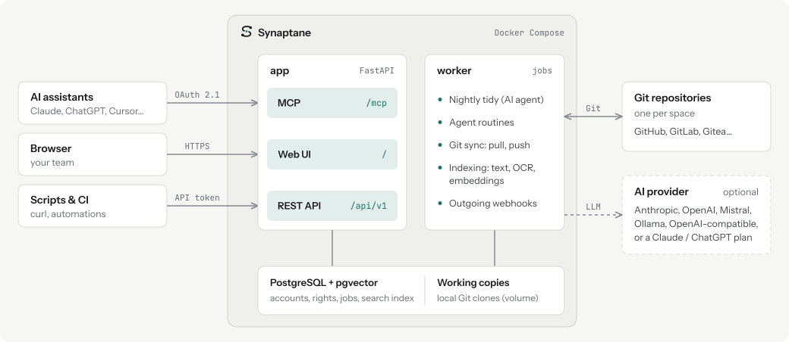

English | [Français](README.fr.md)

<p align="center">
  <picture>
    <source media="(prefers-color-scheme: dark)" srcset="docs/assets/logo-dark.svg">
    
  </picture>
</p>

# Synaptane

**Synaptane is a self-hosted team second brain stored in Git.** Markdown first, and all your
files: pages sit next to PDFs (scans included), Office documents, images and HTML pages, and
everything is searchable. Your AI assistants search it and drop what they learn into an inbox
over MCP. Every night, an AI agent files those notes into the wiki and commits the result.

[](LICENSE)
[](https://github.com/synaptane/synaptane/actions/workflows/ci.yml?query=branch%3Amain+event%3Apush)
[](https://github.com/synaptane/synaptane/releases)
[](pyproject.toml)
[](https://github.com/synaptane/synaptane/pkgs/container/synaptane)

<picture>
  <source media="(prefers-color-scheme: dark)" srcset="docs/assets/screenshot-wiki-dark.png">
  
</picture>

## Why Synaptane?

Your team explains things to AI assistants every day, and that knowledge disappears when the
chat ends. Synaptane gives your assistants a **shared, durable memory that you own**: plain
Markdown pages, with the documents that go with them, in your own Git repository. Assistants
don't just read it, they feed it, and an AI agent keeps it organized every night.

- **Compared with Notion AI, Confluence or Slite:** no lock-in. It is self-hosted, works with
  the model of your choice, and your data is a Git repository.
- **Compared with Outline, Wiki.js, BookStack or Docmost:** it is built around AI assistants,
  and the wiki is maintained for you.
- **Compared with Obsidian, Logseq or Basic Memory:** it is multi-user and server-side: one
  memory for the assistants of the whole team.
- **Compared with Khoj or AnythingLLM:** it does not only answer questions over documents. It
  curates a knowledge base that people can read and edit.

## Features

- **Git is the source of truth.** Each space is a Git repository (GitHub, GitLab, Gitea or any
  other host). Its `content/` folder is your wiki: Markdown pages and the files that go with
  them, which you can read, grep and clone without Synaptane. Every change is a commit. Sync
  works both ways, with conflict resolution.
- **Markdown first, and all your files.** Pages are Markdown, with links, backlinks and
  verification. Next to them, PDFs (scanned ones are read by OCR), Word, Excel and PowerPoint
  documents (and OpenDocument), images, HTML pages, CSV, JSON or code are displayed,
  searchable and readable by your assistants. See
  [Your files, all searchable](#your-files-all-searchable).
- **Built for AI assistants (MCP).** Streamable HTTP with OAuth 2.1 (PKCE, dynamic client
  registration) or personal tokens. 20 tools and 3 prompts. Tested with Claude.ai, Claude
  Desktop, Claude Code and ChatGPT connectors. A connection can be limited to read-only or to
  some spaces.
- **Inbox and nightly tidy-up.** Drop notes from your assistant, the web UI or the REST API.
  An AI agent files them, updates existing pages, fixes links and commits. Each space can
  describe its *purpose* to guide it. Guardrails: a cap of 10 deletions per run, caps on
  tokens, steps and tool calls per run, an optional monthly budget, and one-click undo of a
  run.
- **Scheduled agent routines.** For example a weekly consistency check or a Friday digest.
  Output goes to a report page, the inbox, email or a webhook.
- **Search that finds things.** Full-text search with accent folding and light stemming
  (English and French), including text extracted from PDF, Office documents and images (OCR).
  Optional hybrid semantic search (pgvector, RRF). Related pages for each page.
- **Knowledge you can trust.** Page owners, verification dates and review cycles. A wiki
  health tab (broken links, orphans, old pages). Probable secrets are refused before any
  commit.
- **Bring your own model.** Anthropic, OpenAI, Mistral, Ollama or any OpenAI-compatible
  endpoint, with a key and an optional monthly budget per organization (€20 suggested for
  a pay-per-use key). A Claude or ChatGPT
  subscription can also be used through the official CLIs (see
  [Known limitations](#known-limitations)).
- **Made for teams.** Organizations, spaces, roles (reader, contributor, organization admin,
  super admin), email invitations, single sign-on (OIDC, GitHub, GitLab, Google).
- **Open APIs.** A full REST API and HMAC-signed webhooks. Its OpenAPI schema and interactive
  documentation are off by default (`api_docs` setting).
- **Easy to run.** Docker Compose, behind your own reverse proxy or with a bundled nginx and
  Let's Encrypt. `synaptane doctor` checks the installation. Backups are verified, and can be
  encrypted and copied off-site (age and rclone). Admins get alerts by email.
- **A calm, bilingual UI.** Light and dark themes, English and French, Ctrl+K search.

### Screenshots

Taken on the demo data set (`synaptane demo`): Acme and its people are fictional.

<table>
  <tr>
    <td width="50%"><br><sub><b>Ctrl+K search</b>, across all your spaces</sub></td>
    <td width="50%"><br><sub><b>Inbox</b>: notes and direct changes waiting to be tidied</sub></td>
  </tr>
  <tr>
    <td width="50%"><br><sub><b>Wiki health</b>: broken links, pages to review</sub></td>
    <td width="50%"><br><sub><b>History</b>: every change is a Git commit</sub></td>
  </tr>
  <tr>
    <td width="50%"><br><sub><b>Connect an AI assistant</b> over MCP</sub></td>
    <td width="50%"><br><sub><b>Routines</b>: scheduled agents, such as a weekly consistency check</sub></td>
  </tr>
</table>

## Your files, all searchable

Markdown is the heart of the wiki, but a space holds any file, added from the web UI (25 MB
per file), attached to a note dropped by an assistant, or pushed with Git.

| Format | In the wiki | Search | AI assistants (MCP) |
|---|---|---|---|
| Markdown (`.md`) | Rendered page: links, backlinks, outline, verification, related pages | Words and meaning | Read and write |
| PDF | Built-in viewer | Text layer, or OCR (Tesseract) for scanned pages | Read the extracted text |
| Word, PowerPoint, Excel (`.docx`, `.pptx`, `.xlsx`, and the old `.doc`, `.ppt`, `.xls`), OpenDocument (`.odt`, `.odp`, `.ods`) | Download, extracted text shown below | Extracted text | Read the extracted text |
| Images (PNG, JPEG, GIF, WebP, AVIF, BMP, SVG) | Displayed | Text in the image, by OCR (not SVG or AVIF) | Read the OCR text |
| HTML pages (`.html`, `.htm`) | Rendered in an isolated frame (sandbox), source one click away | Words | Read and write |
| Other text files (CSV, JSON, YAML, code, logs…) | Syntax highlighting | Words | Read and write |
| Anything else | Stored, versioned, downloadable | File name | Listed, no text |

"Meaning" applies to every text above on spaces where semantic search is enabled. The text
of the old `.doc` and `.xls` is read by catdoc (included in the Docker image), that of the old
`.ppt` by Synaptane itself, with limits: details in
[Files other than Markdown](docs/guide/wiki.md#files-other-than-markdown).

## Status

Synaptane is **stable** since `v1.0.0`. It is provided as is and maintained on a best-effort
basis by one person.

Versions follow [Semantic Versioning](https://semver.org/): within 1.x, the REST API, the MCP
tools and the configuration only change in a compatible way. Every change is listed in the
[changelog](CHANGELOG.md). Back up before each upgrade.

### Known limitations

- **Recent features.** Agent routines, related pages and page verification were added
  shortly before this release. Expect rough edges.
- **Claude and ChatGPT subscriptions (Claude Code, Codex).** The published image does not
  include these CLIs: to use a subscription, build the image yourself (see
  [installation](docs/admin/installation.md)). The quota display relies on an undocumented
  Claude Code event and may stop working after a CLI update. The CLI runs under the same
  system account as the worker; running it under a separate account is planned.

  > [!WARNING]
  > **Check the terms of your AI provider.** As of October 2026, Anthropic allows a
  > subscription to be used with the official Claude Code binary only. It forbids third-party
  > applications from handling those credentials, and Pro and Max limits assume ordinary
  > individual use. For an organization shared by several people, use an API key or a Team or
  > Enterprise plan. Details: [AI and tidy-up](docs/admin/ai.md).
- **Anthropic beta features.** With Claude models, Synaptane uses a beta API feature
  (server-side fallback when a safety filter refuses a request). Beta features can change.
- **Costs.** Automatic cost estimates exist only for Claude models (and, for semantic
  search, the embedding models of OpenAI, Gemini, Mistral and Voyage AI). For other
  providers, enter the price per million tokens yourself: without a price, no cost is
  computed and no budget can apply. Vectorizing search queries is not counted.
- **Not there yet:** two-factor authentication; restoring a single page version from the UI
  (the Git history is there).
- **Monitoring:** no `/metrics` endpoint. `/healthz` and `/readyz` exist.
- **Platforms:** Linux, or WSL2 on Windows. macOS is not tested.
- **Language:** the web UI, emails, REST error messages and documentation are in English and
  French. The command line, logs and answers to AI assistants (MCP) are in English.
- **ChatGPT deep research** with the Synaptane connector has not been tested.

## Requirements

- A **Linux server** (or WSL2 to try it out) with **Docker Engine and the Compose plugin**.
- A **domain name served over HTTPS**, for Claude.ai and ChatGPT connectors, OAuth and single
  sign-on. Not needed to try it locally.
- A **Git repository** per space, on any Git host, reachable over HTTPS or SSH.
- **An AI provider, optional.** Without one, the wiki, search, the MCP server and the inbox
  all work. The nightly tidy-up and routines need one. Semantic search needs an embedding
  provider (Ollama works locally).
- **An SMTP server, optional**, for email invitations, password reset and alerts.

## Quick start

On your server, get the files for the release (Compose file, nginx configuration, scripts),
then start the published image:

```sh
git clone --branch v1.4.0 https://github.com/synaptane/synaptane.git ~/synaptane
cd ~/synaptane
cp .env.example .env && chmod 600 .env   # it holds the database password
openssl rand -hex 24                     # copy into POSTGRES_PASSWORD
nano .env                                # PUBLIC_URL, POSTGRES_PASSWORD, mode
docker compose pull
docker compose up -d
docker compose exec app synaptane admin create --username admin   # password: 12 characters or more
docker compose exec app synaptane doctor
```

Git reports a "detached HEAD" after cloning a tag: this is normal. `.env.example` already pins
the image to the release you cloned (`SYNAPTANE_VERSION`).

Then choose how HTTPS is served, in `.env`:

- **Behind the nginx already on the server** (default): Synaptane listens on
  `127.0.0.1:8000`. `deploy/host/install-nginx.sh` installs the site and its Let's Encrypt
  certificate.
- **All-in-one** (`COMPOSE_PROFILES=proxy`): nginx and certbot run in Docker on ports 80 and
  443.

The [installation guide](docs/admin/installation.md) covers both modes, upgrades, rollback and
building the image yourself.

## Try it locally in 2 minutes

```sh
git clone --branch v1.4.0 https://github.com/synaptane/synaptane.git && cd synaptane
printf 'PUBLIC_URL=http://localhost:8000\nPOSTGRES_PASSWORD=%s\nSYNAPTANE_VERSION=1.4.0\n' \
  "$(openssl rand -hex 24)" > .env
chmod 600 .env                                                        # database password
echo 'COMPOSE_FILE=compose.yaml:examples/compose.demo.yaml' >> .env   # demo only
docker compose up -d
docker compose exec app synaptane demo
```

Git reports a "detached HEAD" after cloning a tag: this is normal. Port 8000 already taken?
Add `APP_PORT=8001` to `.env` and use the same port in `PUBLIC_URL`
(`http://localhost:8001`), then in the addresses below.

`synaptane demo` loads the wiki of a fictional IT team
([examples/acme-wiki](examples/acme-wiki/README.md)): 50 pages, verified pages and one to
review, six inbox notes waiting to be tidied. It prints the address to open, the password of
the `demo` account (once) and how to connect an AI assistant. Open
<http://localhost:8000/o/acme/it>, search, browse the inbox and the Health tab. Tidying the
inbox needs an AI provider: see [AI](docs/admin/ai.md).

The demo space uses a local Git repository, which `examples/compose.demo.yaml` allows: keep it
for a throwaway instance. For a real one, skip that line and create the first account with
`docker compose exec app synaptane admin create --username admin`
([installation](docs/admin/installation.md)).

Claude Code can connect to this local instance with a personal token (see below). Claude.ai and
ChatGPT need a public HTTPS address.

## Connect your AI assistant

Synaptane is an MCP server at `https://<your-domain>/mcp`. The exact address is shown in
**My account → Connect an AI assistant (MCP)**.

- **Claude.ai, Claude Desktop:** Settings → Connectors → Add custom connector, paste the
  address, then sign in and allow.
- **ChatGPT:** in developer mode, create a connector with the address and OAuth.
- **Claude Code and other clients:** create a personal token, then:

  ```sh
  claude mcp add --transport http synaptane https://brain.example.com/mcp \
    --header "Authorization: Bearer syn_…"
  ```

Full guide, with the list of tools and prompts: [Connect your AI assistant (MCP)](docs/guide/mcp.md).

## Architecture

One FastAPI app serves the three interfaces: MCP for AI assistants, the web UI and the REST
API. A worker runs everything in the background: the nightly tidy, agent routines, Git sync,
indexing and webhooks. Both share PostgreSQL (with pgvector) and local clones of each space's
Git repository. The AI provider is optional: only the tidy, routines and semantic search need
one.

<picture>
  <source media="(prefers-color-scheme: dark)" srcset="docs/assets/architecture-dark.svg">
  
</picture>

## Documentation

Every page exists in English and French. Start with the [documentation index](docs/index.md)
and the [concepts](docs/concepts.md).

- **Users:** [connect your AI assistant (MCP)](docs/guide/mcp.md),
  [read, write and search the wiki](docs/guide/wiki.md).
- **Administrators:** [installation](docs/admin/installation.md),
  [Git repositories](docs/admin/git.md), [AI and tidy-up](docs/admin/ai.md),
  [single sign-on](docs/admin/sso.md), [webhooks](docs/admin/webhooks.md),
  [backup and restore](docs/admin/backup.md),
  [server scripts](deploy/host/README.md).
- **Reference:** [concepts](docs/concepts.md),
  [repository format](docs/reference/repository-format.md),
  [REST API](docs/reference/api.md), [command line](docs/reference/cli.md).
- **Development:** [working on the code](docs/dev/development.md),
  [evaluation bench](docs/dev/eval.md).

## Contributing

Contributions are welcome. Read [CONTRIBUTING.md](CONTRIBUTING.md) first. Commits must be
signed off under the [Developer Certificate of Origin](https://developercertificate.org/)
(`git commit -s`). Everyone taking part follows the [code of conduct](CODE_OF_CONDUCT.md).
For questions and help, see [SUPPORT.md](SUPPORT.md).

## Security

Please do not report vulnerabilities in public issues. Use GitHub's private vulnerability
reporting, as described in [SECURITY.md](SECURITY.md).

## License

Apache-2.0, see [LICENSE](LICENSE) and [THIRD_PARTY_NOTICES.md](THIRD_PARTY_NOTICES.md).

The published image does not contain Claude Code or Codex. If you build the image with them
(`AGENT_CLIS=true`, the Dockerfile default), you install third-party software under its own
terms.

---

Synaptane is developed with the help of AI coding assistants (Claude); every change is
reviewed by the maintainer.
